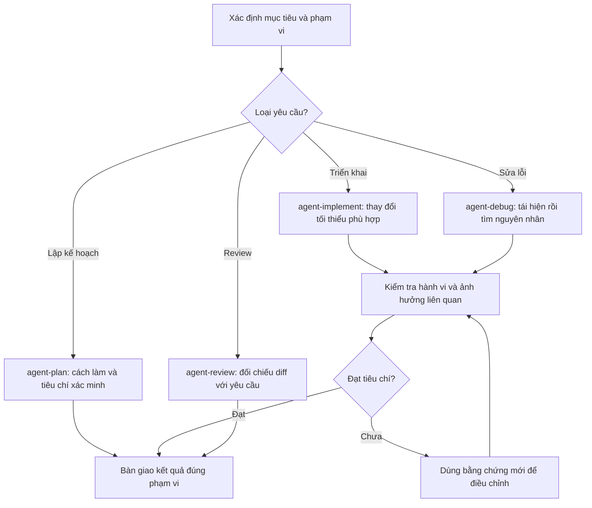

# Hướng dẫn triển khai nguyên tắc Karpathy và dùng bộ skill với agent

Tài liệu này chuyển nội dung repo thành cách làm việc thực tế: giao việc rõ, để agent triển khai trong phạm vi đã giao và kiểm tra kết quả bằng bằng chứng. Bộ skill đi kèm dùng cho công việc kỹ thuật trong repo, có thể điều chỉnh theo ngôn ngữ, framework và công cụ agent đang dùng.

Nền tảng là bốn nguyên tắc trong [`CLAUDE.md`](CLAUDE.md) và các tình huống trong [`EXAMPLES.md`](EXAMPLES.md). Bốn skill mới là phần vận dụng và mở rộng tại bản local này; chúng không được trình bày như nội dung nguyên gốc của Karpathy. Bản tổng quan repo trước khi bổ sung bộ skill nằm ở [`sumary.md`](sumary.md).

## 1. Bắt đầu dùng ngay

Chọn một skill theo công việc hiện tại:

| Việc cần làm | Skill | Kết quả cần nhận |
| --- | --- | --- |
| Làm rõ phạm vi, so sánh hướng đi hoặc lập kế hoạch trước khi sửa | [`agent-plan`](skills/agent-plan/SKILL.md) | Mục tiêu, giả định ảnh hưởng, cách làm tối thiểu và từng bước kèm cách xác minh. |
| Triển khai tính năng, tài liệu, cấu hình hoặc refactor | [`agent-implement`](skills/agent-implement/SKILL.md) | Thay đổi đúng phạm vi, được kiểm tra theo tác động. |
| Điều tra hoặc sửa lỗi đã được báo | [`agent-debug`](skills/agent-debug/SKILL.md) | Trường hợp tái hiện, nguyên nhân có bằng chứng, bản sửa nếu được giao và kiểm tra liên quan. |
| Đánh giá thay đổi, tìm lỗi và kiểm tra phạm vi | [`agent-review`](skills/agent-review/SKILL.md) | Finding có vị trí, điều kiện gây lỗi và tác động; hoặc kết luận không thấy lỗi trong phạm vi đã xem. |

**Dùng ngay khi agent đọc được repo:** gửi yêu cầu theo mẫu này, thay phần nhiệm vụ bằng công việc của bạn:

```text
Đọc skills/agent-implement/SKILL.md và áp dụng cho nhiệm vụ:
thêm chức năng xuất kết quả đang được lọc trên màn hình thành CSV.
Dùng các cột đang hiển thị và quy ước tải file hiện có của dự án.
Hoàn thành khi dữ liệu xuất khớp bộ lọc, ký tự Unicode đúng,
và các kiểm tra liên quan vẫn pass.
```

Nếu dự án chưa có màn hình, bộ lọc hoặc quy ước được mô tả, agent phải xác minh ngữ cảnh và làm rõ phần thiếu. Ví dụ này không ngầm bổ sung những thành phần đó vào mọi dự án.

Mỗi skill độc lập. Chọn `agent-debug` cho một bug rõ ràng có thể đi thẳng tới sửa lỗi. `agent-plan` hữu ích khi cần chốt hướng làm hoặc người dùng yêu cầu kế hoạch. Với sửa lỗi chính tả, thực hiện và kiểm tra trực tiếp thường đã đủ.

## 2. Chuyển bốn nguyên tắc thành thao tác cụ thể

| Nguyên tắc gốc | Thao tác thực tế | Bằng chứng để đánh giá |
| --- | --- | --- |
| Think Before Coding | Đọc nguồn liên quan; xác định kết quả mong đợi; phân biệt dữ kiện với giả định; làm rõ mơ hồ ảnh hưởng đến kết quả. | Quyết định có căn cứ từ repo hoặc câu trả lời của người dùng. |
| Simplicity First | Dùng pattern đang có; chọn giải pháp đáp ứng nhu cầu hiện tại; giải thích lý do nếu cần thêm abstraction hoặc dependency. | Thành phần mới có yêu cầu cụ thể để phục vụ. |
| Surgical Changes | Giữ diff tập trung; theo style hiện tại; dọn phần thừa do thay đổi mới tạo ra. | Mỗi nhóm thay đổi liên hệ được với mục tiêu đã giao. |
| Goal-Driven Execution | Đặt tiêu chí hoàn thành; thực hiện; kiểm tra; điều chỉnh theo kết quả cho đến khi đạt hoặc gặp chặn thực tế. | Có kết quả kiểm tra thực chạy và ghi rõ phần chưa xác minh. |

### Chuẩn bị ngữ cảnh trước khi sửa

Agent nên đọc chỉ dẫn dự án, điểm vào của chức năng, nơi gọi liên quan, test và lệnh kiểm tra hiện có. Dùng tìm kiếm để mở rộng theo bằng chứng; một nhiệm vụ nhỏ thường chỉ cần một phần repo. Khi làm việc trong workspace có thay đổi sẵn, cần giữ nguyên công việc của người dùng.

Nếu chưa biết cách chạy test, tìm trong tài liệu và cấu hình của chính dự án. Đừng ghi một lệnh như `npm test` vào kế hoạch chỉ vì dự án khác từng dùng nó.

### Quyết định khi nào cần hỏi

| Tình huống | Cách xử lý |
| --- | --- |
| Có thể xác minh câu trả lời bằng repo hoặc hội thoại | Tìm và đọc nguồn đó trước. |
| Có quy ước sẵn, lựa chọn nhỏ và dễ đảo ngược | Theo quy ước, nêu giả định nếu ảnh hưởng tới cách hiểu kết quả. |
| Hai cách hiểu dẫn đến đầu ra hoặc hợp đồng khác nhau | Hỏi câu cụ thể để chốt phần ảnh hưởng; tiếp tục phần độc lập đã rõ. |
| Người dùng đã giao thực hiện và phạm vi đã rõ | Tiếp tục thực hiện; kế hoạch là công cụ điều phối công việc. |

Ví dụ, “search nhanh hơn” cần xác định latency, throughput hay cảm giác phản hồi giao diện. Có thể đọc số đo và code trước; chưa có thông tin thì hỏi mục tiêu tối ưu. Thêm log vào một hàm đã chỉ rõ thường có đủ ngữ cảnh để thực hiện ngay.

### Chọn giải pháp tối thiểu đủ dùng

Với bài toán tính giảm giá phần trăm, một hàm có thể đủ. Với lưu tùy chọn, bắt đầu từ hợp đồng lưu dữ liệu đã được yêu cầu. Cache, nhiều chiến lược hoặc hệ thống cấu hình cần có nhu cầu thực tế để giải thích.

“Đơn giản” vẫn bao gồm validation, xử lý lỗi, tính nhất quán và yêu cầu vận hành thực sự cần. Ví dụ, rate limit in-memory chỉ phù hợp khi mô hình triển khai cho phép; nếu yêu cầu đã nêu nhiều server và bộ đếm chung, nhu cầu đó phải được đáp ứng ngay.

### Giữ diff tập trung

Khi review diff của chính mình, agent cần giải thích được mỗi nhóm thay đổi phục vụ mục tiêu nào. Sửa validator email không tự kéo theo đổi quy tắc username. Thêm logging không cần đổi toàn bộ dấu nháy hoặc chữ ký hàm. Import vừa bị bản sửa làm thừa nên được dọn; dead code cũ nằm ngoài nhiệm vụ có thể được ghi nhận riêng.

## 3. Giao việc bằng tiêu chí hoàn thành

Một yêu cầu tốt nên có các thông tin ảnh hưởng tới việc thực hiện. Mẫu dưới đây là điểm bắt đầu; có thể bỏ các dòng không cần thiết:

```text
Mục tiêu: kết quả cụ thể cần đạt.
Bối cảnh: file/chức năng liên quan, hành vi hiện tại hoặc dữ liệu mẫu.
Phạm vi: phần được thay đổi và giao diện/hành vi cần giữ.
Ràng buộc: yêu cầu kỹ thuật hoặc vận hành thực sự có.
Hoàn thành khi: các hành vi hoặc đầu ra có thể quan sát được.
Xác minh: test, phép đo, kiểm tra trực tiếp hoặc lệnh chuẩn của dự án.
```

Ví dụ cho từng loại nhiệm vụ:

| Loại | Tiêu chí đủ cụ thể |
| --- | --- |
| Tính năng | File CSV chứa đúng các hàng đang được lọc và giữ đúng ký tự tiếng Việt. |
| Bug | Đầu vào tái hiện lỗi cho kết quả mong đợi sau sửa; test liên quan vẫn pass. |
| Refactor | Giao diện hàm và kết quả với các trường hợp được hỗ trợ vẫn giữ nguyên; kiểm tra trước và sau phù hợp. |
| Tài liệu | Hướng dẫn khớp cấu hình hiện có, liên kết nội bộ hợp lệ và ví dụ có thể chạy khi chúng được trình bày là chạy được. |
| Hiệu năng | Cùng dữ liệu, tải và môi trường đo, đạt ngưỡng đã thống nhất mà vẫn giữ tính đúng. |

Các mục tiêu tốc độ cần được thống nhất theo nhu cầu và số đo thật của dự án. Các con số trong hội thoại minh họa của `EXAMPLES.md` không phải benchmark để áp cho mọi repo.

## 4. Quy trình thực hiện theo từng loại công việc



Vòng lặp tiếp tục khi có hành động hữu ích để tiến gần tiêu chí hoàn thành. Nếu thiếu dữ liệu, quyền truy cập hoặc công cụ cần thiết, agent cần nêu chính xác phần bị chặn và phần đã hoàn thành. Skill không mở rộng quyền thực hiện của môi trường hoặc yêu cầu người dùng.

### Lập kế hoạch: `agent-plan`

```text
Dùng agent-plan để khảo sát chức năng export hiện tại và đề xuất
cách thêm CSV cho kết quả đang được lọc. Chỉ lập kế hoạch.
Nêu file có khả năng cần sửa, giả định còn ảnh hưởng,
và cách kiểm tra dữ liệu xuất khớp bộ lọc.
```

Kết quả mong đợi là kế hoạch dựa trên code thật. Nếu chưa có chức năng export, kế hoạch phải nói rõ phát hiện đó. Yêu cầu “chỉ lập kế hoạch” giữ công việc ở phạm vi khảo sát và đề xuất.

### Triển khai: `agent-implement`

```text
Dùng agent-implement để thêm logging cho hàm upload_file đang có.
Ghi nhận bắt đầu, thành công và thất bại theo logging convention của repo.
Giữ giao diện hàm và hành vi trả về hiện tại.
Kiểm tra các nhánh upload liên quan và báo kết quả thực chạy.
```

Agent cần hoàn thành phần thay đổi được giao, kiểm tra rồi báo kết quả. Hướng dẫn không yêu cầu xin duyệt lại sau mỗi bước hoặc bắt buộc tạo tài liệu kế hoạch cho một hàm nhỏ.

### Sửa lỗi: `agent-debug`

```text
Dùng agent-debug để sửa sort_scores: điểm giảm dần,
trùng điểm thì tên tăng dần.
Bob=100, Charlie=90, Alice=100 phải cho Alice, Bob, Charlie.
Tạo kiểm tra tái hiện, sửa đúng phạm vi và kiểm tra hồi quy liên quan.
```

Đầu tiên phải biết hợp đồng hòa điểm là gì. Nếu người dùng chỉ nói “trùng điểm bị lỗi”, hãy làm rõ hoặc xác minh hợp đồng trong dự án trước khi chọn xếp tên hay giữ thứ tự đầu vào.

Ví dụ độc lập dưới đây kiểm tra được hợp đồng xếp tên. Đầu vào cố ý đặt Bob trước Alice để việc chỉ sort theo điểm không thể vô tình pass:

```python
def test_sort_scores():
    scores = [
        {"name": "Bob", "score": 100},
        {"name": "Charlie", "score": 90},
        {"name": "Alice", "score": 100},
    ]
    assert sort_scores(scores) == [
        {"name": "Alice", "score": 100},
        {"name": "Bob", "score": 100},
        {"name": "Charlie", "score": 90},
    ]


def sort_scores(scores):
    return sorted(scores, key=lambda item: (-item["score"], item["name"]))


test_sort_scores()
```

Khi áp dụng test-first, viết test trước và xác nhận nó fail với implementation lỗi. Trong ví dụ này, implementation chỉ dùng `key=lambda item: -item["score"]` sẽ fail; thêm khóa tên sẽ pass. Chỉ assert dãy điểm `100, 100, 90` như ví dụ hiện có trong `EXAMPLES.md` chưa kiểm tra được hợp đồng hòa điểm theo tên.

### Review: `agent-review`

```text
Dùng agent-review để review các thay đổi chưa commit trong repo.
Đối chiếu với yêu cầu thêm logging cho upload_file.
Báo lỗi có điều kiện tái hiện, vị trí file/dòng và tác động.
Chỉ review; cho biết phạm vi và các kiểm tra thực sự đã chạy.
```

Một finding tốt chỉ ra phần code và trường hợp cụ thể gây sai. Sở thích đặt tên hoặc đề xuất kiến trúc chưa gắn với tác động thực tế nên được phân biệt với lỗi cần sửa. Nếu đã đọc đủ phạm vi mà không thấy lỗi đáng báo, kết luận đó là hợp lệ; vẫn cần nói phần chưa được kiểm tra khi nó giới hạn kết luận.

## 5. Chọn mức kiểm chứng phù hợp

| Thay đổi | Kiểm tra nên cân nhắc theo tác động |
| --- | --- |
| Tài liệu, ví dụ | Liên kết, lệnh và cấu hình được mô tả; chạy ví dụ nếu tuyên bố nó chạy được. |
| Cấu hình | Parse hoặc validation schema, đường dẫn tham chiếu, khả năng nạp của công cụ khi có môi trường. |
| Logic nghiệp vụ | Trường hợp hành vi chính và các nhánh biên liên quan đến thay đổi. |
| Bug | Test/bước tái hiện trước sửa, kiểm tra sau sửa và hồi quy liên quan. |
| Refactor | Kiểm tra baseline trước sửa khi khả thi và hành vi sau sửa. |

Luôn thực hiện các check mà dự án quy định. Sau khi các kiểm tra phù hợp đã pass, mở rộng hoặc chạy lại khi có thay đổi mới, lỗi mới hoặc nghi vấn chưa giải quyết. Không cần thêm test máy móc cho mọi chỉnh sửa tài liệu hay một dòng hiển nhiên.

Phân biệt lỗi của bản sửa, lỗi có trước và lỗi môi trường. Nếu không chạy được một check, báo lý do cụ thể; đọc code không tương đương với test pass.

Một báo cáo bàn giao ngắn nên nói: đã thay đổi gì và vì sao; kiểm tra nào thực sự chạy và kết quả; phần chưa xác minh hoặc còn bị chặn nếu có. Chỉ thêm chi tiết phục vụ đánh giá kết quả.

## 6. Đưa bộ skill vào công cụ đang dùng

### Nguồn nằm ở đâu?

```text
skills/
├── karpathy-guidelines/SKILL.md     # Skill nguyên tắc gốc
├── agent-plan/
├── agent-implement/
├── agent-debug/
└── agent-review/
    ├── SKILL.md                    # Mỗi skill mới đều có hai file này
    └── agents/openai.yaml          # Metadata giao diện tùy chọn cho Codex
```

Mỗi skill mới có hướng dẫn tự đủ dùng và metadata giao diện. Không cần dependency ngoài hoặc script thực thi. `agents/openai.yaml` cung cấp tên hiển thị, mô tả ngắn và prompt gợi ý; không tắt khả năng lựa chọn skill tự động.

### Codex

Để Codex tự khám phá trong dự án đích, copy **toàn bộ bốn thư mục** `skills/agent-*` vào `.agents/skills/` của dự án đó. Ví dụ, `agent-debug/SKILL.md` sẽ nằm tại `.agents/skills/agent-debug/SKILL.md`. Thư mục nguồn `skills/` trong repo này phục vụ đóng gói, tự nó không phải đường dẫn khám phá project mặc định của Codex. [Tài liệu OpenAI về skill](https://learn.chatgpt.com/docs/build-skills).

Trong Codex CLI/IDE, dùng `/skills` hoặc gọi `$agent-debug`, `$agent-implement` kèm nhiệm vụ. Codex cũng có thể chọn theo mô tả skill. Nếu chưa thấy skill sau thay đổi, thử khởi động lại phiên. Tránh nhiều bản cùng tên để dễ chọn đúng nguồn. [Cách Codex nạp và gọi skill](https://learn.chatgpt.com/docs/build-skills).

Việc tạo bộ này mới đặt nguồn trong repo; chưa copy vào cấu hình cá nhân hoặc đường dẫn khám phá của dự án đích.

### Claude Code

Manifest [`.claude-plugin/plugin.json`](.claude-plugin/plugin.json) đã khai báo skill gốc và bốn skill mới. Với Claude Code CLI đã cài, mở terminal ở gốc repo này rồi nạp plugin local:

```text
claude --plugin-dir .
```

Khi làm ở dự án khác, truyền đường dẫn tuyệt đối tới repo chứa plugin thay cho `.`. Gọi workflow bằng tên có namespace, ví dụ:

```text
/andrej-karpathy-skills:agent-debug Sửa sort_scores theo yêu cầu đã mô tả.
```

Claude Code hỗ trợ nạp plugin từ thư mục bằng `--plugin-dir`; skill của plugin có namespace theo tên plugin. [Tài liệu plugin Claude Code](https://code.claude.com/docs/en/plugins).

Các thay đổi này đang ở bản local. Lệnh cài từ marketplace GitHub trong README chỉ lấy phiên bản đã được phát hành ở nguồn đó; nó chưa tự chứa bốn skill mới vừa tạo ở đây. Tài liệu này không thực hiện cài đặt hoặc phát hành plugin.

### Cursor hoặc agent khác có thể đọc file

Trong Cursor, bộ nguyên tắc gốc đã được cấu hình tại [`.cursor/rules/karpathy-guidelines.mdc`](.cursor/rules/karpathy-guidelines.mdc); xem [`CURSOR.md`](CURSOR.md) để mang rule sang dự án khác.

Để áp dụng workflow mới với agent có thể đọc repo, dùng mẫu “Đọc `skills/agent-review/SKILL.md` và áp dụng cho…” như đầu tài liệu. Việc đọc file theo yêu cầu là cách dùng trực tiếp; nó chưa đăng ký skill vào cơ chế khám phá riêng của công cụ.

## 7. Điều chỉnh và đánh giá bộ skill

Các skill dùng tiếng Việt ở phần hướng dẫn và mô tả tiếng Anh ngắn trong frontmatter để nêu phạm vi. Thêm kiến thức riêng của dự án khi nó ảnh hưởng quyết định: lệnh test thật, hợp đồng API, giới hạn triển khai hoặc quy ước quan trọng. Kiến thức dài chỉ cần trong một tình huống có thể đưa vào `references/` và liên kết từ skill tương ứng.

Những quyết định áp dụng bổ sung so với bản nguyên tắc gốc gồm: hỏi theo mức ảnh hưởng, kiểm tra theo tác động, báo đúng giới hạn bằng chứng, và phân biệt review với sửa code. Chúng giúp vận dụng nguyên tắc vào nhiệm vụ cụ thể; không tạo yêu cầu mọi việc đều phải theo đủ bốn workflow.

| Tình huống thử | Hành vi mong đợi |
| --- | --- |
| Chỉ yêu cầu lập kế hoạch export | Khảo sát và đưa kế hoạch; giữ nguyên code. |
| Thêm logging cho một hàm đã chỉ rõ | Sửa tập trung, giữ style và hành vi sẵn có. |
| Sửa sorting trùng điểm | Xác minh hợp đồng hòa điểm; kiểm tra thứ tự tên nếu hợp đồng yêu cầu. |
| Chỉ yêu cầu review | Trả finding có bằng chứng hoặc kết luận trong phạm vi đã xem; giữ nguyên code. |
| Lệnh test lỗi do thiếu dependency | Báo chặn môi trường và phần chưa kiểm tra; không báo test pass. |
| Sửa một lỗi chính tả | Thực hiện và kiểm tra trực tiếp, giữ quy trình gọn. |

Đây là các ca để kiểm tra hành vi khi đưa skill vào agent thực tế. Kiểm tra YAML hoặc đường dẫn chỉ xác nhận cấu trúc; chúng không chứng minh agent sẽ làm đúng các ca này. Khi gặp lỗi sử dụng thật, sửa đúng chỉ dẫn gây lỗi và thử lại tình huống đó, tránh tích lũy thêm quy tắc chung không cần thiết.
