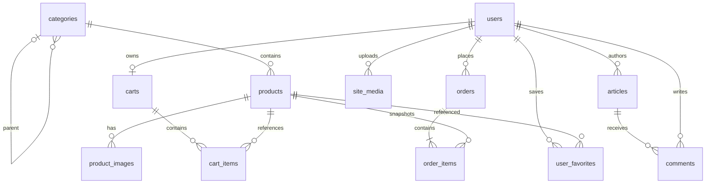

# Database — DB-01 / DB-02 / DB-03

Nguồn: `spec.md` §5, §9; `rules.md` §4, §7. Phạm vi P0: chuẩn bị dữ liệu cho sáu bounded contexts. Người thực hiện: Codex trong workspace hiện tại. SQL trong `migrations/` là nguồn schema chuẩn; không dùng ORM/framework.

DB-02/03: bảy migration và seed nội dung đã chạy trên `computer_store` của NAS `192.168.1.200:32771`, MySQL **26.7.0**. Có 21 bảng dữ liệu/hỗ trợ và bảng kỹ thuật `schema_migrations`. Integration tests chạy riêng trong `computer_store_test`; không tạo fixtures trong DB ứng dụng. Giữ InnoDB/utf8mb4/DECIMAL và constraint baseline.

## Entities và ownership

| Module | Entity / bảng | Quyết định chính |
| --- | --- | --- |
| User | User / users | Email duy nhất; member/admin; active/locked/disabled; password hash private; Guest không có bản ghi |
| Product | Category / categories | Slug duy nhất; parent tùy chọn; active/hidden |
| Product | Product / products | SKU/slug duy nhất; giá không âm; stock unsigned; active/hidden/discontinued; thông số dạng text |
| Product | ProductImage / product_images | Đường dẫn nội bộ; tối đa một ảnh primary mỗi sản phẩm |
| Cart | Cart / carts | Một giỏ persistent mỗi user; Guest dùng PHP Session |
| Cart | CartItem / cart_items | Một dòng mỗi (cart, product); quantity > 0 |
| Order | Order / orders | Mã đơn duy nhất; COD; pending/confirmed/shipping/completed/cancelled |
| Order | OrderItem / order_items | Snapshot product_name, sku, unit_price; quantity > 0 |
| Article | Article / articles | Slug duy nhất; draft/published/hidden; published cần published_at |
| Comment | Comment / comments | Pending mặc định; approved/hidden; nội dung không rỗng |
| Contact | Contact / contacts | unread/read/replied |
| Faq | Faq / faqs | active/hidden; sort_order |
| Site | Page / pages | Slug duy nhất; draft/published/hidden; SEO metadata |
| Site | SiteSetting / site_settings | setting_key duy nhất |
| Site | Service / services | Dịch vụ và giá chung một bảng; không có thanh toán dịch vụ |
| User | user_favorites | PK (user_id, product_id), FK; Guest dùng Session |
| User | auth_attempts | Giới hạn thử đăng nhập theo hash IP/email và cửa sổ thời gian |
| Order | coupons | Mã duy nhất, basis points, trần giảm DECIMAL, active |
| Contact | newsletter_subscribers | Email duy nhất; không gửi email tự động |
| Site | site_media | File path nội bộ duy nhất, MIME/size/uploader/status |
| Technical | data_seeds | Ledger seed nội dung một lần |

15 entity PHP baseline là immutable row data trong `app/Modules/<module>/Entities/`, không gọi DB. Repositories/services hiện dùng validated arrays và allowlist DTO cho các projection API, gồm cột bổ sung của 007; SQL là nguồn schema chuẩn. Giá là **decimal string**, timestamp UTC; Service xử lý validation, quyền và transaction. HTTP không serialize trực tiếp User/password hash.

Migration 007 bổ sung short_name/detail cho category, old_price cho product, subtotal/discount/shipping_fee/coupon_code cho order, image snapshot cho order_item, section bài viết và metadata nội dung/cài đặt/dịch vụ. Sáu bảng mới bên trên chỉ phục vụ hành vi UI hiện có theo DB-03.

## Quan hệ

contacts, faqs, pages, site_settings, services, newsletter_subscribers và coupons độc lập. Các entity baseline có bigint unsigned PK, created_at/updated_at; favorites dùng composite PK, auth_attempts/data_seeds dùng natural key. Giá DECIMAL(15,2), InnoDB, utf8mb4_0900_ai_ci. Search dùng prepared LIKE, escape `%`/`_` thành literal; danh sách phân trang SQL LIMIT/OFFSET. Chưa thêm FULLTEXT.

## Xóa, ảnh và lịch sử

- RESTRICT quan hệ tới user, category, product, order để giữ lịch sử; user/product bị vô hiệu hóa/ẩn khi có dữ liệu liên quan.
- Xóa cart cascade cart_items; xóa article cascade comments. Service sở hữu quyết định có được xóa sau khi kiểm tra quyền/nghiệp vụ.
- product_images dùng generated primary_product_id + UNIQUE. FK product dùng RESTRICT vì MySQL giới hạn cascade trên cột nền của stored generated column; phải xóa ảnh trước khi hard delete sản phẩm nếu được phép. [MySQL: generated columns và FK](https://dev.mysql.com/doc/refman/8.0/en/create-table-generated-columns.html).
- Uploader Admin nhận JPG/PNG/WebP tối đa 5 MB, Fileinfo/kích thước ảnh, tên random; file ở public/uploads, metadata trong site_media. Danh mục chỉ xuất /assets/ hoặc /uploads/, chặn traversal/hotlink.
- `backend:seed-store` nạp JSON nội dung công khai một lần, có transaction/ledger; không ghi đè sửa đổi. Không nhập tài khoản, đơn hàng hay dữ liệu localStorage. Seed catalog cũ tạo ba sản phẩm độc lập. Admin được tạo riêng bằng CLI, password_hash, không có mật khẩu mặc định.

## Transaction Sales

OrderService điều phối trên cùng PDO với Cart/Catalog/User/Site:

1. Sales mở transaction trên một PDO connection; lấy user từ session server.
2. Khóa giỏ Member; Catalog khóa product theo ID nhất quán bằng FOR UPDATE, dùng giá/stock từ locking read thay vì snapshot read cũ của REPEATABLE READ; trừ kho qua CatalogService.
3. Sales tạo order + snapshot items + xóa giỏ trong cùng transaction; tính tiền bằng decimal/integer minor units, không dùng float cho business calculations.
4. Admin hủy từ pending/confirmed: khóa order; kiểm tra trạng thái/inventory_restored_at; Catalog hoàn kho; cập nhật status, cancelled_at và inventory_restored_at trong **cùng câu UPDATE**, rồi commit. CHECK chỉ cho timestamp này xuất hiện khi cancelled. Service lock/state mới bảo đảm hoàn một lần; CHECK không thay transaction.
5. OrderStatus::canTransitionTo() mô tả BR-08; completed/cancelled là trạng thái cuối. delivered của prototype không phải giá trị DB.

Coupon/favorites/newsletter/media duy trì hành vi UI theo DB-03; không có payment gateway hoặc shipping integration. Ít nhất một item mỗi order và total = subtotal - discount + shipping_fee là invariant của transaction/service. Server kiểm coupon/phí giao hàng từ DB, client expectedTotal chỉ phát hiện giá thay đổi.

## Migrations và kiểm thử

backend:migrate chạy bảy file theo tên, ghi version + SHA-256 (chuẩn hóa CRLF/LF) trong schema_migrations và lấy advisory lock. Chạy lại bỏ qua file đã áp dụng; từ chối checksum thay đổi. MySQL DDL tự commit: file lỗi có thể đã áp dụng một phần; runner không tự drop bảng hay giả định rollback. Kiểm tra trạng thái trước khi khôi phục; tạo migration mới khi schema đã chia sẻ.

backend:test-db chỉ dùng DB riêng có đuôi _test, mặc định computer_store_test. Kiểm uniqueness, FK, CHECK, ảnh primary, snapshot, hidden products, pending comments và rollback stock; fixtures nghiệp vụ rollback.

backend:test-http tạo fixtures có prefix ngẫu nhiên trong DB _test, khởi PHP cổng tạm và dọn fixtures sau test. Kiểm cookie/CSRF/register/login, quyền/ownership, persistence profile/favorites/cart/CMS, upload, checkout tổng tiền/rollback và cancel hoàn kho một lần. Hai PHP worker riêng kiểm checkout tranh sản phẩm stock=1 và hủy đồng thời. Chưa chạy trên instance MySQL 8 riêng; NAS 26.7.0 là môi trường kiểm thực tế.
