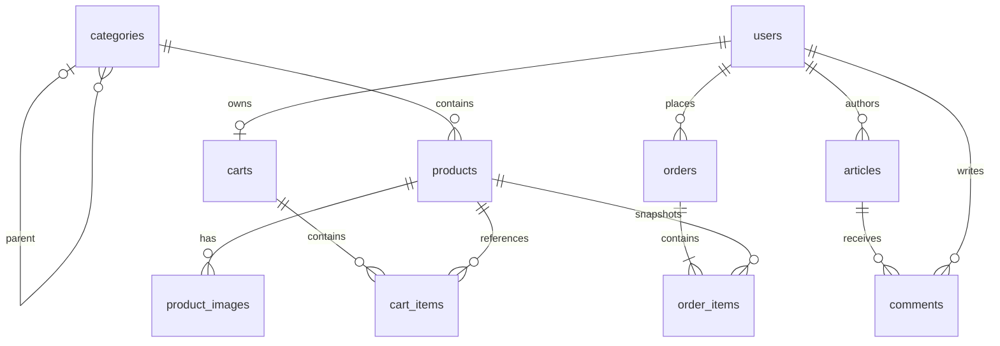

# Database baseline — DB-01

Nguồn: `spec.md` §5, §9; `rules.md` §4, §7. Phạm vi P0: chuẩn bị dữ liệu cho sáu bounded contexts. Người thực hiện: Codex trong workspace hiện tại. SQL trong `migrations/` là nguồn schema chuẩn; không dùng ORM/framework.

DB-02: sáu migration và seed đã chạy trên `computer_store` của NAS `192.168.1.200:32771`, MySQL **26.7.0**. Integration tests chạy riêng trong `computer_store_test`, không sử dụng bảng ứng dụng để tạo fixtures. Baseline SQL vẫn dùng InnoDB/utf8mb4/DECIMAL và các constraint đã mô tả; xem rules/spec cho ngoại lệ phiên bản NAS.

## Entities và ownership

| Module | Entity / bảng | Quyết định chính |
| --- | --- | --- |
| User | User / users | Email duy nhất; member/admin; active/locked/disabled; password hash private; Guest không có bản ghi |
| Product | Category / categories | Slug duy nhất; parent tùy chọn; active/hidden |
| Product | Product / products | SKU/slug duy nhất; giá không âm; stock unsigned; active/hidden/discontinued; thông số dạng text |
| Product | ProductImage / product_images | Đường dẫn nội bộ; tối đa một ảnh primary mỗi sản phẩm |
| Cart | Cart / carts | Một giỏ persistent mỗi user; Guest sẽ dùng session |
| Cart | CartItem / cart_items | Một dòng mỗi (cart, product); quantity > 0 |
| Order | Order / orders | Mã đơn duy nhất; COD; pending/confirmed/shipping/completed/cancelled |
| Order | OrderItem / order_items | Snapshot product_name, sku, unit_price; quantity > 0 |
| Article | Article / articles | Slug duy nhất; draft/published/hidden; published cần published_at |
| Comment | Comment / comments | Pending mặc định; approved/hidden; nội dung không rỗng |
| Contact | Contact / contacts | unread/read/replied |
| Faq | Faq / faqs | active/hidden; sort_order |
| Site | Page / pages | Slug duy nhất; draft/published/hidden; SEO metadata |
| Site | SiteSetting / site_settings | setting_key duy nhất |
| Site | Service / services | Dịch vụ và giá chung một bảng; không có thanh toán dịch vụ |

Entity PHP là immutable row data trong `app/Modules/<module>/Entities/`, không gọi DB. Giá giữ dạng **decimal string**, timestamp dạng chuỗi UTC; repository hydrate dữ liệu. Service sẽ thực hiện validation, authorization, transaction và business operations. Khi triển khai Identity phải dùng DTO/allowlist cho HTTP response, không tự serialize User.

## Quan hệ

contacts, faqs, pages, site_settings, services độc lập. Mỗi bảng có bigint unsigned PK và created_at/updated_at; giá DECIMAL(15,2), InnoDB, utf8mb4_0900_ai_ci. Index theo FK và bộ lọc/trang đã xác định. Search tên/SKU dùng prepared LIKE; escape `%`/`_` thành literal. Chưa thêm FULLTEXT khi chưa có yêu cầu/ngưỡng dữ liệu cần đến.

## Xóa, ảnh và lịch sử

- RESTRICT quan hệ tới user, category, product, order để giữ lịch sử; user/product bị vô hiệu hóa/ẩn khi có dữ liệu liên quan.
- Xóa cart cascade cart_items; xóa article cascade comments. Service sở hữu quyết định có được xóa sau khi kiểm tra quyền/nghiệp vụ.
- product_images dùng generated primary_product_id + UNIQUE. FK product dùng RESTRICT vì MySQL giới hạn cascade trên cột nền của stored generated column; phải xóa ảnh trước khi hard delete sản phẩm nếu được phép. [MySQL: generated columns và FK](https://dev.mysql.com/doc/refman/8.0/en/create-table-generated-columns.html).
- Media lưu đường dẫn nội bộ do uploader backend tạo trong tương lai. Danh mục hiện chỉ xuất đường dẫn /assets/ hoặc /uploads/, chặn traversal/hotlink. Chưa có upload endpoint.
- Seed tạo ba sản phẩm và một danh mục; không tạo tài khoản/mật khẩu. Chạy lại không ghi đè tên/giá/tồn kho hiện có.

## Chuẩn bị transaction Sales

**Chưa triển khai checkout/cancel service.** Schema chuẩn bị để thực hiện:

1. Sales mở transaction trên một PDO connection; lấy user từ session server.
2. Catalog khóa sản phẩm theo thứ tự ID nhất quán; đọc giá/stock thực và trừ kho qua inventory service Catalog.
3. Sales tạo order + snapshot items + xóa giỏ trong cùng transaction; tính tiền bằng decimal/integer minor units, không dùng float cho business calculations.
4. Admin hủy từ pending/confirmed: khóa order; kiểm tra trạng thái/inventory_restored_at; Catalog hoàn kho; cập nhật status, cancelled_at và inventory_restored_at trong **cùng câu UPDATE**, rồi commit. CHECK chỉ cho timestamp này xuất hiện khi cancelled. Service lock/state mới bảo đảm hoàn một lần; CHECK không thay transaction.
5. OrderStatus::canTransitionTo() mô tả BR-08; completed/cancelled là trạng thái cuối. delivered của prototype không phải giá trị DB.

Không thêm coupon, wishlist, payment gateway, shipping integration hay dữ liệu P2. Ít nhất một item mỗi order và total bằng tổng snapshot là invariant của transaction/service, không thể chỉ dựa vào FK/CHECK.

## Migrations và kiểm thử

backend:migrate chạy sáu file theo tên, ghi version + SHA-256 (chuẩn hóa CRLF/LF) trong schema_migrations và lấy advisory lock. Chạy lại bỏ qua file đã áp dụng; từ chối checksum thay đổi. MySQL DDL tự commit: file lỗi có thể đã áp dụng một phần; runner không tự drop bảng hay giả định rollback. Kiểm tra trạng thái trước khi khôi phục; tạo migration mới khi schema đã chia sẻ.

backend:test-db chỉ dùng database riêng có đuôi _test, mặc định computer_store_test. Migrate/seed tạo dữ liệu demo trong DB test, fixtures nghiệp vụ được rollback. Kiểm tra uniqueness, FK, CHECK, ảnh primary, snapshot, hidden products, pending comments và rollback stock. Chưa có test checkout/cancel/concurrency vì flow đó chưa triển khai.

Tiêu chí DB-01/DB-02: migration chạy và chạy lại không đổi schema; 15 entity khớp cột/enums; DB test chặn dữ liệu không hợp lệ; catalog SSR/Fetch trả dữ liệu MySQL có pagination. Đã chạy đạt 9 database integration tests trên NAS MySQL 26.7.0 cùng kiểm tra HTTP frontend–PHP–MySQL. Chưa chạy test trên một instance MySQL 8 riêng trong phiên này.
