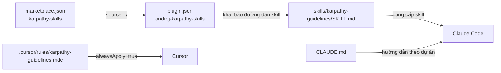
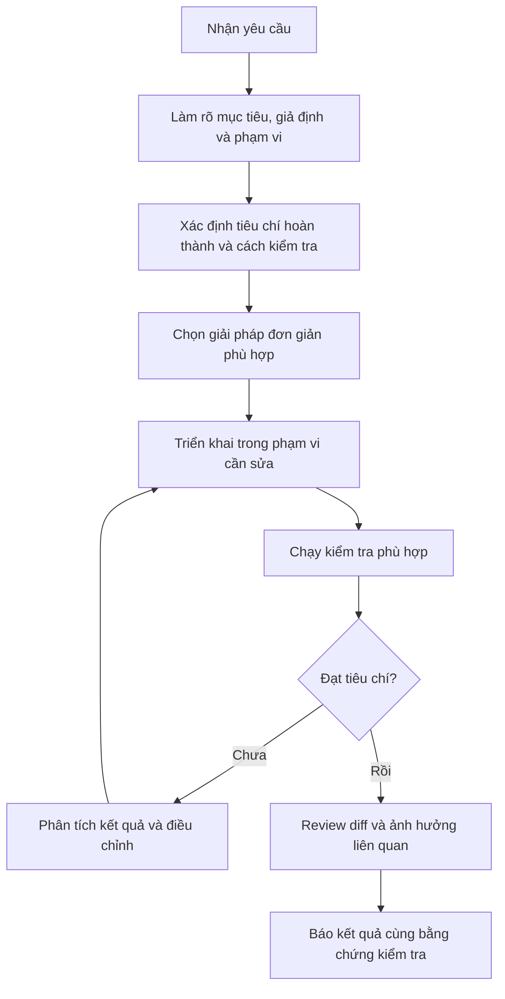

# Tổng quan repo `andrej-karpathy-skills`

> Tài liệu tiếng Việt, dựa trên việc đọc toàn bộ 9 file được Git theo dõi tại thời điểm khảo sát ngày 22/10/2026. Không tính thư mục quản lý phiên bản `.git/` và file `sumary.md` được bổ sung này. Các lệnh cài đặt bên dưới được ghi lại từ tài liệu trong repo; chưa được chạy để cài plugin.

## 1. Repo này làm gì?

Repo cung cấp **bộ hướng dẫn hành vi cho AI hỗ trợ lập trình**, nhằm giảm các lỗi thường gặp: tự suy diễn yêu cầu, làm giải pháp quá phức tạp, sửa lan sang phần không liên quan và hoàn thành công việc mà thiếu bằng chứng kiểm tra.

Sản phẩm chính là **nội dung hướng dẫn bằng Markdown**, được cung cấp dưới ba hình thức: file `CLAUDE.md` cho dự án, skill được đóng gói thành plugin Claude Code, và project rule cho Cursor. Nội dung lấy cảm hứng từ những nhận xét của Andrej Karpathy về hạn chế của LLM khi viết code. Metadata ghi tác giả plugin là `forrestchang`.

| Khía cạnh | Nội dung thực tế trong repo |
| --- | --- |
| Mục tiêu | Giúp AI hiểu đúng yêu cầu, viết đơn giản, sửa đúng phạm vi và kiểm chứng kết quả. |
| Thành phần cốt lõi | Bốn nguyên tắc được viết thành chỉ dẫn cho agent. |
| Cách thực hiện | Đưa cùng nội dung vào định dạng mà Claude Code hoặc Cursor có thể sử dụng. |
| Phần minh họa | Chín ví dụ trong `EXAMPLES.md`, có Python, diff và hội thoại mẫu. |
| Đóng gói | Hai manifest JSON cho marketplace và plugin; phiên bản khai báo đều là `1.0.0`. |
| Thực thi | Tool AI bên ngoài đọc và áp dụng hướng dẫn; repo không chứa chương trình tự chạy quy trình này. |

Repo hiện không có ứng dụng frontend/backend, API đang triển khai, cơ sở dữ liệu, dependency manifest, build script, bộ test thực thi hay cấu hình CI. Vì vậy, không có bước `npm install`, chạy server hoặc build ứng dụng để sử dụng nội dung này. Các đoạn code trong tài liệu là ví dụ để học cách làm việc với AI.

## 2. Cấu trúc và vai trò của toàn bộ file

```text
andrej-karpathy-skills/
├── .claude-plugin/
│   ├── marketplace.json
│   └── plugin.json
├── .cursor/
│   └── rules/
│       └── karpathy-guidelines.mdc
├── skills/
│   └── karpathy-guidelines/
│       └── SKILL.md
├── CLAUDE.md
├── CURSOR.md
├── EXAMPLES.md
├── README.md
├── README.zh.md
└── sumary.md                         # Tài liệu tổng hợp này
```

| File | Vai trò và nội dung chính |
| --- | --- |
| [`README.md`](README.md) | Giới thiệu vấn đề, giải thích bốn nguyên tắc, hướng dẫn cài plugin hoặc dùng `CLAUDE.md`, dẫn sang tài liệu Cursor, nêu cách đánh giá hiệu quả và tùy biến. Có liên kết tới nhận xét của Karpathy, dự án Multica và tài khoản X được giới thiệu. |
| [`README.zh.md`](README.zh.md) | Bản tiếng Trung giản thể của README, có cùng các nhóm nội dung và hướng dẫn sử dụng. |
| [`CLAUDE.md`](CLAUDE.md) | Bản hướng dẫn ngắn gọn để đưa vào dự án: bốn nguyên tắc, các hành vi cụ thể, mẫu kế hoạch có bước kiểm tra và dấu hiệu áp dụng có hiệu quả. |
| [`skills/karpathy-guidelines/SKILL.md`](skills/karpathy-guidelines/SKILL.md) | Đóng gói các nguyên tắc thành skill `karpathy-guidelines`; có YAML frontmatter mô tả tên, tình huống sử dụng và license. Đây là nội dung skill mà plugin cung cấp. |
| [`.claude-plugin/plugin.json`](.claude-plugin/plugin.json) | Khai báo plugin `andrej-karpathy-skills`, mô tả, phiên bản, tác giả, license, từ khóa và đường dẫn đến thư mục skill. |
| [`.claude-plugin/marketplace.json`](.claude-plugin/marketplace.json) | Khai báo marketplace `karpathy-skills`, chủ sở hữu và danh sách plugin để phân phối. Hiện danh sách chỉ có một plugin, lấy nguồn từ thư mục gốc repo. |
| [`.cursor/rules/karpathy-guidelines.mdc`](.cursor/rules/karpathy-guidelines.mdc) | Bản dành cho Cursor, gồm mô tả, `alwaysApply: true` và toàn bộ bốn nguyên tắc. |
| [`CURSOR.md`](CURSOR.md) | Hướng dẫn dùng rule trong repo và dự án khác, tùy chọn personal skill, phân biệt cách dùng với Claude Code và yêu cầu đồng bộ nội dung khi đóng góp. |
| [`EXAMPLES.md`](EXAMPLES.md) | Chín ví dụ đối chiếu cách AI thường làm sai với cách nên làm, bảng tổng hợp anti-pattern và giải thích vì sao cần trì hoãn độ phức tạp đến khi có nhu cầu thực tế. |

Các liên kết Multica và X nằm trong phần giới thiệu/tham khảo của README. Repo không chứa mã nguồn nền tảng Multica hay phần tích hợp chạy nền tảng đó.

## 3. Bốn nguyên tắc cốt lõi

### 3.1. Think Before Coding — Suy nghĩ trước khi viết code

**Mục đích:** làm rõ yêu cầu và các lựa chọn trước khi quyết định cách triển khai.

- Nói rõ các giả định; hỏi khi sự không chắc chắn ảnh hưởng tới cách làm.
- Nếu yêu cầu có nhiều cách hiểu, trình bày các cách hiểu thay vì tự chọn mà không thông báo.
- Đề xuất cách đơn giản hơn nếu có; phản biện khi hướng được yêu cầu có vấn đề.
- Khi chưa hiểu, chỉ ra cụ thể phần chưa rõ để làm rõ trước khi triển khai.

Ví dụ: “export dữ liệu user” còn thiếu phạm vi user, trường dữ liệu, định dạng, nơi nhận file và lượng dữ liệu. “Search nhanh hơn” có thể chỉ thời gian phản hồi, số truy vấn xử lý đồng thời hoặc cảm giác phản hồi của giao diện. Mỗi cách hiểu dẫn tới một giải pháp khác nhau.

### 3.2. Simplicity First — Ưu tiên đơn giản

**Mục đích:** dùng lượng code và thiết kế vừa đủ để giải quyết yêu cầu hiện tại.

- Triển khai tính năng đã được yêu cầu.
- Chỉ tạo abstraction khi có nhu cầu thực tế; một đoạn code dùng một lần thường chưa cần framework riêng.
- Chỉ thêm khả năng cấu hình hoặc mở rộng khi bài toán cần đến.
- Xử lý lỗi theo các tình huống có thể xảy ra trong phạm vi thực tế; tránh thêm nhánh cho tình huống bất khả thi.
- Xem lại độ dài và độ phức tạp: nếu 200 dòng có thể giải quyết rõ ràng bằng 50 dòng, cần đơn giản hóa.

Ví dụ: tính số tiền giảm theo phần trăm có thể dùng một hàm ngắn. Chưa cần hệ thống `DiscountStrategy`, nhiều subclass, cấu hình và calculator nếu chưa có yêu cầu nhiều loại giảm giá.

**Cách tự kiểm tra của repo:** một kỹ sư có kinh nghiệm có thấy giải pháp này quá phức tạp không?

### 3.3. Surgical Changes — Thay đổi đúng phạm vi

**Mục đích:** giữ bản sửa tập trung, dễ review và giảm ảnh hưởng ngoài yêu cầu.

- Sửa các dòng cần thiết để hoàn thành nhiệm vụ; giữ phong cách code sẵn có.
- Giữ nguyên phần code, comment và định dạng lân cận khi chúng không liên quan tới nhiệm vụ.
- Chỉ refactor phần có lý do trực tiếp trong công việc đang làm.
- Dọn import, biến hoặc hàm trở nên thừa do chính thay đổi mới tạo ra.
- Nếu gặp dead code đã tồn tại từ trước và không liên quan, ghi nhận để người dùng quyết định xử lý.

Ví dụ: thêm logging cho upload cần thêm log ở các điểm phù hợp, đồng thời giữ quy ước dấu nháy, chữ ký hàm và logic trả về đang có.

**Cách tự kiểm tra của repo:** có giải thích được mỗi dòng thay đổi liên quan thế nào tới yêu cầu không?

### 3.4. Goal-Driven Execution — Thực hiện theo mục tiêu có thể kiểm chứng

**Mục đích:** xác định bằng chứng hoàn thành để AI có thể tự sửa và kiểm tra cho đến khi đạt yêu cầu.

| Yêu cầu ban đầu | Chuyển thành mục tiêu kiểm chứng |
| --- | --- |
| Thêm validation | Có test cho input không hợp lệ và implementation làm các test đó pass. |
| Sửa bug | Tái hiện được bug bằng test, sửa cho test pass, rồi kiểm tra chức năng liên quan. |
| Refactor | Các test vẫn pass trước và sau khi thay đổi cấu trúc. |

Với công việc nhiều bước, mỗi bước cần đi cùng cách xác minh:

```text
1. Tái hiện vấn đề → kiểm tra: test thể hiện lỗi hiện tại.
2. Sửa đúng phạm vi → kiểm tra: test tái hiện đã pass.
3. Kiểm tra ảnh hưởng → kiểm tra: test liên quan vẫn pass, diff đúng yêu cầu.
```

Ý chính của repo là **giao cả điều kiện thành công cho AI**, giúp AI có cơ sở lặp lại quá trình làm và kiểm tra. “Làm cho nó chạy được” thường chưa đủ rõ để xác nhận hoàn thành.

## 4. Cách repo đóng gói và đưa hướng dẫn vào công cụ



Sơ đồ mô tả các đường đưa nội dung vào công cụ. Việc nạp và áp dụng do công cụ thực hiện; trong repo không có code loader, hook hay agent executor riêng.

### Metadata có ý nghĩa gì?

| Nơi khai báo | Trường quan trọng | Ý nghĩa |
| --- | --- | --- |
| `marketplace.json` | `name` và `id`: `karpathy-skills`; `owner.name`: `forrestchang` | Tên, định danh và chủ sở hữu marketplace. |
| `marketplace.json` | `plugins[0].name`: `andrej-karpathy-skills`; `source`: `./` | Plugin được phân phối và vị trí nguồn ngay tại gốc repo. |
| `marketplace.json` | `metadata.version` và `plugins[0].version`: `1.0.0` | Phiên bản được khai báo trong metadata marketplace và mục plugin. |
| `marketplace.json` | `category`: `workflow` | Nhóm công dụng của plugin trong marketplace. |
| `plugin.json` | `name`: `andrej-karpathy-skills`; `version`: `1.0.0` | Tên và phiên bản plugin. |
| `plugin.json` | `skills`: `["./skills/karpathy-guidelines"]` | Danh sách thư mục skill được cung cấp; hiện chỉ có một skill. |
| `SKILL.md` | `name`: `karpathy-guidelines` | Tên skill, khác với tên plugin và marketplace. |
| `SKILL.md` | `description` | Mô tả phạm vi dùng khi viết, review hoặc refactor code; nhấn mạnh đơn giản hóa, sửa đúng phạm vi, làm rõ giả định và kiểm chứng. |
| `.mdc` | `alwaysApply: true` | Rule được cấu hình luôn áp dụng trong phạm vi project Cursor. |
| `plugin.json`, `SKILL.md` | `license`: `MIT` | License được khai báo; README cũng ghi MIT. |

Hai manifest còn có mô tả và từ khóa `guidelines`, `best-practices`, `coding`, `karpathy` phục vụ nhận diện nội dung. Những trường này không bổ sung logic thực thi.

### Quan hệ giữa ba bản hướng dẫn

`CLAUDE.md`, `.cursor/rules/karpathy-guidelines.mdc` và `skills/karpathy-guidelines/SKILL.md` chứa cùng nội dung bốn nguyên tắc. Đối chiếu tại thời điểm khảo sát cho thấy phần từ nguyên tắc 1 đến hết nguyên tắc 4 giống nhau; phần đầu file khác để phù hợp định dạng từng công cụ. `CLAUDE.md` và rule Cursor có thêm câu nhắc các dấu hiệu áp dụng hiệu quả ở cuối.

Repo chưa có script tự sinh hoặc tự đồng bộ ba bản. [`CURSOR.md`](CURSOR.md) yêu cầu giữ `CLAUDE.md` và rule Cursor đồng bộ khi sửa nguyên tắc; cập nhật cả `SKILL.md` nếu muốn nội dung skill/plugin được phát hành tương ứng.

## 5. Toàn bộ ví dụ trong `EXAMPLES.md`

File gồm **chín tình huống**, phân bổ theo bốn nguyên tắc:

| Nguyên tắc | Tình huống | Bài học thực hiện |
| --- | --- | --- |
| Think Before Coding | Export dữ liệu user | Làm rõ phạm vi user, trường dữ liệu, cách nhận kết quả và quy mô trước khi chọn cách export. |
| Think Before Coding | Làm search nhanh hơn | Phân biệt latency, throughput và tốc độ cảm nhận trên giao diện trước khi chọn index, cache, async hoặc progressive loading. |
| Simplicity First | Tính giảm giá | Dùng một hàm cho phép tính đơn giản; mở rộng thiết kế khi xuất hiện nhiều loại giảm giá thực sự cần hỗ trợ. |
| Simplicity First | Lưu tùy chọn user vào database | Bắt đầu bằng thao tác lưu cần thiết; thêm cache, merge, validation hoặc notification theo yêu cầu và ngữ cảnh thực tế. |
| Surgical Changes | Sửa validator bị lỗi với email trống | Chỉ sửa phần xử lý email liên quan, giữ nguyên các quy tắc username và phần khác. |
| Surgical Changes | Thêm logging cho upload | Thêm log và giữ phong cách code hiện có; tránh kéo theo đổi định dạng hay refactor không cần thiết. |
| Goal-Driven Execution | Sửa xác thực | Chuyển yêu cầu chung thành lỗi cụ thể, ví dụ session cũ còn hiệu lực sau khi đổi mật khẩu; tái hiện, sửa và kiểm tra hồi quy. |
| Goal-Driven Execution | Thêm rate limit cho API | Chia thành các bước có thể kiểm tra: in-memory cho một endpoint, middleware, Redis khi cần nhiều server, cấu hình khi cần nhiều mức giới hạn. |
| Goal-Driven Execution | Sắp xếp khi trùng điểm | Tái hiện tình huống bằng test, sau đó sắp theo điểm giảm dần và tên tăng dần khi bằng điểm. |

Cuối file là bảng tổng hợp các anti-pattern: tự quyết định yêu cầu, tạo abstraction sớm, sửa lan và làm việc với tiêu chí mơ hồ. Thông điệp là độ phức tạp phải xuất hiện đúng lúc có nhu cầu, kể cả khi thiết kế phức tạp đó trông hợp “best practice”.

**Chi tiết cần hiểu khi đọc ví dụ:** đây là các đoạn minh họa, chưa phải bộ test hoặc ứng dụng hoàn chỉnh trong repo. Riêng ví dụ trùng điểm, test hiện chỉ assert các giá trị điểm, chưa assert thứ tự tên. Để chứng minh quy tắc xử lý hòa điểm, cần thêm kiểm tra thứ tự tên với đầu vào thích hợp, chẳng hạn Bob và Alice cùng 100 điểm phải cho kết quả Alice trước Bob.

Các con số thời gian, latency và coverage được trình bày trong hội thoại mẫu không phải số đo thực nghiệm của repo này.

## 6. Cách sử dụng thực tế

### 6.1. Claude Code qua plugin

Theo [`README.md`](README.md), chạy hai lệnh này bên trong Claude Code:

```text
/plugin marketplace add forrestchang/andrej-karpathy-skills
/plugin install andrej-karpathy-skills@karpathy-skills
```

Chuỗi `andrej-karpathy-skills@karpathy-skills` ghép **tên plugin** với **tên marketplace**. Plugin khai báo đường dẫn tới skill `karpathy-guidelines`; chính `SKILL.md` chứa hướng dẫn hành vi.

Cài plugin cung cấp skill cho công cụ. Cách công cụ chọn và nạp skill phụ thuộc cơ chế của công cụ; manifest trong repo không có thiết lập `alwaysApply` như rule Cursor.

### 6.2. Claude Code theo từng dự án

1. Đưa nội dung [`CLAUDE.md`](CLAUDE.md) vào `CLAUDE.md` ở thư mục gốc dự án cần áp dụng.
2. Nếu dự án đã có file này, hợp nhất nội dung với quy ước hiện có.
3. Bổ sung các quy định thực tế của dự án: ngôn ngữ, phong cách code, cách xử lý lỗi, lệnh kiểm tra hoặc yêu cầu test.

README cũng có ví dụ tải file bằng `curl` cho dự án mới và nối nội dung vào file đã có. Copy/hợp nhất file local là một cách tương đương để sử dụng nội dung repo đang đọc.

### 6.3. Cursor

**Trong chính repo này:** mở thư mục bằng Cursor; rule đã nằm tại `.cursor/rules/karpathy-guidelines.mdc` và có `alwaysApply: true`. [`CURSOR.md`](CURSOR.md) hướng dẫn kiểm tra trong Settings → Rules hoặc giao diện project rules tương ứng.

**Ở dự án khác:** tạo `.cursor/rules/` nếu cần, copy file `.mdc` vào đó và hợp nhất với các rule sẵn có của dự án.

**Tùy chọn personal skill:** `CURSOR.md` đề cập copy hoặc symlink skill từ `skills/karpathy-guidelines/SKILL.md` vào cấu trúc personal skills dưới `~/.cursor/skills`.

Theo `CURSOR.md`, Cursor không mặc định đọc `.claude-plugin/` hoặc `CLAUDE.md`. Bản `.mdc` là cách repo cung cấp project rule cho Cursor.

### 6.4. Cách áp dụng vào một nhiệm vụ cụ thể



Đây là sơ đồ diễn giải quy trình từ bốn nguyên tắc; repo không có chương trình thực thi sơ đồ. Với bug, test tái hiện cần có trước bản sửa. Với refactor, kiểm tra trạng thái trước và sau. Với thay đổi đơn giản như sửa lỗi chính tả, chọn mức kiểm tra phù hợp thay vì áp dụng toàn bộ quy trình máy móc.

Ví dụ một yêu cầu rõ để giao cho AI trong dự án có hàm `sort_scores`:

```text
Mục tiêu: sửa sort_scores để sắp điểm giảm dần;
khi trùng điểm, sắp tên tăng dần.

Trường hợp kiểm tra: Bob=100, Alice=100, Charlie=90
phải cho thứ tự Alice, Bob, Charlie.

Phạm vi: phần sắp xếp và test liên quan; giữ giao diện hàm hiện có.
Cách làm: tạo test thể hiện lỗi, sửa tối thiểu, chạy test liên quan.
Kết quả cần báo: phần đã sửa, lệnh kiểm tra thực sự chạy và kết quả.
```

## 7. Đánh giá hiệu quả và duy trì repo

### Nhận biết hướng dẫn có tác dụng

README và `CLAUDE.md` nêu các dấu hiệu quan sát được:

- Diff tập trung vào yêu cầu, có ít thay đổi không liên quan.
- Giải pháp đơn giản hơn, giảm nhu cầu viết lại vì thiết kế quá phức tạp.
- Các điểm mơ hồ được làm rõ trước khi triển khai.
- PR gọn, dễ review và có kết quả kiểm chứng.

Đây là tiêu chí đánh giá hành vi. Repo chưa cung cấp benchmark hay số liệu định lượng chứng minh mức cải thiện.

### Khi muốn chỉnh sửa hoặc mở rộng

1. Sửa nội dung nguyên tắc và đồng bộ các bản `CLAUDE.md`, rule Cursor, `SKILL.md` theo phạm vi phát hành.
2. Cập nhật ví dụ trong `EXAMPLES.md` nếu hành vi hoặc cách áp dụng thay đổi.
3. Cập nhật cả README tiếng Anh và tiếng Trung nếu cách dùng hoặc nội dung giới thiệu thay đổi.
4. Nếu đổi tên, phiên bản hoặc đường dẫn skill, kiểm tra lại các khai báo tương ứng trong hai manifest và lệnh cài đặt.
5. Kiểm tra JSON hợp lệ, đường dẫn tồn tại, frontmatter đúng và các liên kết nội bộ còn trỏ đúng.

Các bước trên là hướng dẫn bảo trì rút ra từ cấu trúc hiện có; repo chưa có script hay CI để tự động thực hiện chúng.

### Giới hạn của cách tiếp cận

- Đây là chỉ dẫn bằng ngôn ngữ tự nhiên; hiệu quả phụ thuộc việc công cụ nạp hướng dẫn và agent thực hiện chúng. Repo không có cơ chế cưỡng chế bằng code.
- Bộ nguyên tắc chủ ý thiên về thận trọng cho công việc phức tạp. README yêu cầu dùng phán đoán với thay đổi nhỏ để tránh tăng thủ tục không cần thiết.
- Quy tắc chung cần kết hợp với yêu cầu thực tế của dự án. Ví dụ, “đơn giản” vẫn phải đáp ứng validation và xử lý lỗi mà chức năng thực sự cần.
- License được khai báo là MIT trong tài liệu và metadata, nhưng snapshot đang đọc chưa có file `LICENSE` riêng.

## 8. Thứ tự đọc để nắm repo nhanh

1. Đọc [`CLAUDE.md`](CLAUDE.md) để nắm trọn bốn nguyên tắc trong bản ngắn nhất.
2. Đọc [`EXAMPLES.md`](EXAMPLES.md) để thấy mỗi nguyên tắc tác động thế nào tới code và cách giao tiếp.
3. Chọn hướng sử dụng: [`README.md`](README.md) cho Claude Code hoặc [`CURSOR.md`](CURSOR.md) cho Cursor.
4. Đọc [`SKILL.md`](skills/karpathy-guidelines/SKILL.md) và hai manifest nếu cần hiểu cách skill được đóng gói thành plugin.
